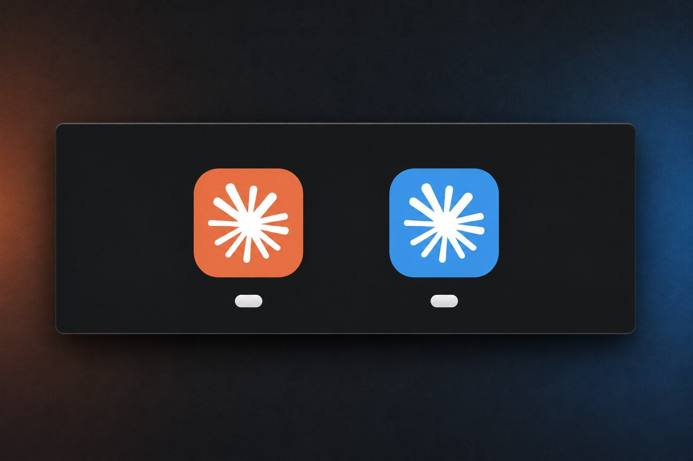

# Claude Desktop Side by Side

[English](README.md) | [Português (Brasil)](README.pt-BR.md) | **Español**

<p align="center">
  
</p>
<p align="center"><b>Tu cuenta principal de Claude en naranja, una segunda cuenta en azul.<br>Las dos abiertas al mismo tiempo, cada una con su propio botón en la barra de tareas.</b></p>

> [!IMPORTANT]
> **Para iniciar sesión en cada perfil adicional, usa "Continue with email": escribe tu correo y luego escribe en la app el código que recibas. No hagas clic en el enlace del correo y no uses "Continue with Google".**
> El inicio de sesión con Google (y el enlace del correo) te devuelve a la ventana principal de Claude, así que el nuevo perfil nunca termina de iniciar sesión. [Detalles](#sign-in-important)

Usa **dos o más cuentas de Claude Desktop al mismo tiempo**, por ejemplo una cuenta personal y una del trabajo, o cuentas de dos empresas diferentes. Cada una tiene su propia ventana y su propio **ícono de color**.

Se acabó cerrar sesión y volver a entrar para cambiar de cuenta.

**Ir a:** [Instalar en Windows](#install-windows) · [Instalar en macOS](#macos-experimental) · [Iniciar sesión](#sign-in-important) · [`/handoff`](#handoff)

| Plataforma | Estado | Qué obtienes |
|---|---|---|
| **Windows 10/11** | ✅ Probado | Cuentas separadas lado a lado, acceso directo de color en el escritorio y el menú Inicio **y botón de color en la barra de tareas**, además de [`/handoff`](#handoff) para seguir una conversación de Claude Code en otra cuenta |
| **macOS** | 🧪 Experimental, sin probar | Cuentas separadas lado a lado y una app lanzadora de color (Dock/Launchpad/Spotlight). La ventana abierta mantiene el ícono normal de Claude en el Dock |

> **Solución alternativa no oficial, hecha por la comunidad.** No está afiliada, respaldada ni soportada por Anthropic. Usa el comportamiento estándar de Electron y del sistema operativo, no una función documentada de Claude, así que una actualización de la app podría romperla. El soporte nativo para varias cuentas se pidió en [anthropics/claude-code#18435](https://github.com/anthropics/claude-code/issues/18435). Si tú también lo quieres, deja un 👍 allí.

## Cómo funciona

- Cada perfil es una instancia separada de Claude Desktop, abierta con la opción `--user-data-dir` de Electron, así que tiene **su propio inicio de sesión, configuración e historial**. Tu Claude Desktop normal no se modifica y sigue siendo tu cuenta "principal".
- El ícono de color se genera **en tu computadora**, a partir de tu Claude instalado, cambiando su tono. No se descarga nada.
- En Windows, el lanzador también le da a la ventana del perfil su propia identidad en la barra de tareas (AppUserModelID), para que tenga su propio botón de color.

---

## Windows

### Requisitos

- Windows 10 u 11
- Claude Desktop instalado desde [claude.ai/download](https://claude.ai/download) o la Microsoft Store
- Windows PowerShell 5.1 (incluido en Windows)

Probado en Windows 11 con Claude Desktop 4.23118 (versión de la Microsoft Store/MSIX). El instalador clásico está soportado por el script, pero se ha probado menos. Los reportes son bienvenidos.

<a id="install-windows"></a>
### Crear un perfil

Hay dos formas de instalar. Las dos hacen exactamente lo mismo, así que elige una.

#### Instalación rápida (una línea)

1. Abre el menú **Inicio**, escribe `powershell` y pulsa **Enter**. El Símbolo del sistema (`cmd`) también funciona.
2. Copia esta línea, pégala en la ventana (**Ctrl+V** o clic derecho) y pulsa **Enter**:

   ```powershell
   powershell -NoProfile -ExecutionPolicy Bypass -Command "cd ([IO.Path]::GetTempPath()); iwr https://github.com/pdmoura/claude-desktop-side-by-side/archive/refs/heads/main.zip -OutFile claude-side-by-side.zip -UseBasicParsing; Expand-Archive claude-side-by-side.zip claude-side-by-side -Force; & .\claude-side-by-side\claude-desktop-side-by-side-main\claude-profile.ps1 -Install -Name Trabajo -Color blue"
   ```

   El final de la línea, `-Name Trabajo -Color blue`, es el nombre de la cuenta y el color de su ícono. Puedes cambiarlos antes de pulsar Enter: consulta [Opciones](#install-options).

Esto descarga la versión actual de este proyecto en tu carpeta Temp y ejecuta el instalador de inmediato. Si prefieres leer los scripts antes de ejecutarlos, usa el paso a paso de abajo.

#### Paso a paso (descargando primero)

1. **Descarga los archivos.** Arriba en esta página, haz clic en el botón verde **Code** y luego en **Download ZIP**. En tu carpeta Descargas, haz clic derecho en el archivo ZIP y elige **Extraer todo**. Si usas Git, también puedes clonarlo: `git clone https://github.com/pdmoura/claude-desktop-side-by-side.git`

   Lee los scripts antes de ejecutarlos, como deberías hacer con cualquier script de internet. [`claude-profile.ps1`](claude-profile.ps1) es el instalador. [`claude-handoff.ps1`](claude-handoff.ps1) y la carpeta [`skills`](skills/handoff/SKILL.md) añaden [`/handoff`](#handoff).
2. **Abre PowerShell en esa carpeta.** Abre la carpeta extraída en el Explorador de archivos. Si solo ves otra carpeta con el mismo nombre, ábrela también: estás en el lugar correcto cuando ves el archivo `claude-profile.ps1`. Luego haz clic en la barra de direcciones de arriba, escribe `powershell` y pulsa **Enter**. Se abre una ventana de PowerShell, ya en la carpeta correcta.
3. **Ejecuta el instalador.** Copia esta línea, pégala en la ventana de PowerShell (**Ctrl+V** o clic derecho) y pulsa **Enter**:

   ```powershell
   powershell -ExecutionPolicy Bypass -File .\claude-profile.ps1 -Install -Name Trabajo -Color blue
   ```

<a id="install-options"></a>
#### Opciones

Van al final de la línea de instalación, en cualquiera de las dos formas. En la instalación rápida, déjalas antes de las comillas `"` del final.

- `-Name`: un nombre para esta cuenta. Solo letras sin tilde, números, `-` y `_` (p. ej. `Trabajo`, `EmpresaX`, `Personal`).
- `-Color`: el color del ícono. Consulta [Colores](#colors).
- **Opcional, solo si usas Claude Code en la terminal:** añade `-Cli` después del color. También crea el comando `claude-trabajo`, que abre Claude Code en la terminal con esta cuenta. Necesita [Claude Code](https://docs.claude.com/en/docs/claude-code) instalado (el comando `claude`), y la primera vez te pide iniciar sesión.

#### Qué deberías ver

Cuando termina, la ventana muestra `Profile 'Trabajo' installed.` y aparece un acceso directo **Claude (Trabajo)** en el escritorio y en el menú Inicio. Si en su lugar aparece un mensaje de error, [abre un issue](../../issues) y pega el mensaje allí.

El instalador también copia los scripts a `%LOCALAPPDATA%\ClaudeProfiles\` y configura [`/handoff`](#handoff) en todas las cuentas. Todo queda instalado en tu usuario de Windows, no dentro de la carpeta descargada, así que puedes borrar esa carpeta después: los accesos directos siguen funcionando y `/handoff` funciona en cualquier proyecto.

#### Próximos pasos

1. **Inicia sesión.** Abre **Claude (Trabajo)**, haz clic en **Continue with email**, escribe tu correo y luego **escribe en la app el código** que te llegue por correo. No hagas clic en el enlace del correo y no uses Google ([por qué](#sign-in-important)).
2. **Añade más cuentas.** Ejecuta la línea de instalación otra vez, con otro nombre y otro color, para cada cuenta adicional.

### Uso diario

- Abre cada cuenta desde su acceso directo. La app principal y todos los perfiles pueden estar abiertos al mismo tiempo.
- **Barra de tareas:** unos segundos después de abrirlo, el botón del perfil en la barra de tareas cambia a su color y se separa del botón de Claude principal.
- **Anclarlo:** haz clic derecho en el *botón de color* del perfil abierto y elige **Anclar a la barra de tareas**. El botón anclado mantiene el color y abre ese perfil.
- Si la ventana de un perfil se abrió de otra forma (no desde su acceso directo o botón anclado), puede mostrar el ícono predeterminado. Ábrelo de nuevo desde el acceso directo para corregirlo.

### Otros comandos

```powershell
$cp = "$env:LOCALAPPDATA\ClaudeProfiles\claude-profile.ps1"

powershell -ExecutionPolicy Bypass -File $cp -List                                  # listar perfiles
powershell -ExecutionPolicy Bypass -File $cp -Install -Name Trabajo -Color purple    # cambiar el color (mantiene la sesión)
powershell -ExecutionPolicy Bypass -File $cp -Uninstall -Name Trabajo                # quitar accesos directos, mantener la sesión
powershell -ExecutionPolicy Bypass -File $cp -Uninstall -Name Trabajo -RemoveData    # quitar todo lo de ese perfil
powershell -ExecutionPolicy Bypass -File $cp -Name Trabajo -OpenUrl "claude://..."   # enviar un enlace de inicio de sesión a ese perfil
```

Cierra la ventana del perfil (y sal de él desde la bandeja del sistema) antes de desinstalarlo.

Después de cambiar el color, abre el perfil de nuevo desde su acceso directo. Si lo anclaste a la barra de tareas, desánclalo y vuelve a anclarlo, porque Windows guarda en caché los íconos anclados.

<a id="handoff"></a>
### Continuar una conversación en otra cuenta (/handoff)

**Esto es solo para Claude Code**: la pestaña **Code** de Claude Desktop, o `claude` en la terminal. Los chats normales no cambian. Si no usas Claude Code, puedes saltarte esta sección.

Normalmente, una conversación de Claude Code se queda en la cuenta donde la empezaste. Con `/handoff` puedes llevarla a otra cuenta y seguir allí, con todo lo que ya se dijo. Después puedes traerla de vuelta de la misma forma.

**Ejemplo:** empezaste una conversación en la ventana principal de Claude y quieres seguirla en **Claude (Trabajo)**.

1. En la conversación, escribe `/handoff Trabajo` y envíalo. Usa el nombre que le diste al perfil al instalarlo. Claude hace el resto y te avisa cuando termina.
2. No envíes más mensajes en esa conversación en la ventana principal.
3. Si **Claude (Trabajo)** ya está abierto, ciérralo por completo: haz clic derecho en su ícono junto al reloj (en la bandeja del sistema) y elige **Salir**. Luego ábrelo de nuevo desde su acceso directo.
4. En **Claude (Trabajo)**, ve a la pestaña **Code**. La conversación está en la barra lateral, dentro de la misma carpeta del proyecto. Haz clic en ella y sigue.

Para traerla de vuelta, escribe `/handoff Desktop` en **Claude (Trabajo)** (`Desktop` es la cuenta de la ventana principal de Claude) y sigue los mismos pasos.

**En la terminal** (si instalaste con `-Cli`): después del handoff, abre una terminal en la misma carpeta del proyecto, ejecuta el comando de la cuenta (por ejemplo `claude-trabajo`), escribe `/resume` y elige la conversación.

| Escribe | Qué hace |
|---|---|
| `/handoff Trabajo` | Lleva esta conversación a la cuenta Trabajo: su ventana y su comando `claude-trabajo` |
| `/handoff Desktop` | La lleva a la cuenta de la ventana principal de Claude |
| `/handoff refresh` | Deja la ventana y el comando de terminal de esta cuenta con la misma copia, para que puedas cambiar entre ellos |

**Es bueno saber**

- **Haz el handoff justo antes de cambiar.** Cada ventana y cada comando de terminal guarda su propia copia de la conversación, y el handoff la copia tal como está en ese momento. Lo que envíes después se queda solo donde lo enviaste. Esto también vale para cambiar entre la ventana y la terminal de la misma cuenta: usa `/handoff refresh` en ese caso.
- **Archiva, no borres.** Para quitar de una cuenta una conversación que llevaste a otra, archívala. Borrarla puede borrarla también en las otras cuentas.
- **"Siguió en más de un lugar":** significa que se enviaron mensajes en dos cuentas sin un handoff de por medio. No se cambia nada. Claude muestra qué copias tienen mensajes que las otras no tienen y pregunta cuál conservar. Las demás se guardan como archivos de respaldo (`.diverged`), nunca se borran.
- **Las cuentas nuevas** reciben `/handoff` automáticamente la próxima vez que instales un perfil.
- **Experimental, solo en Windows.** Depende de cómo Claude guarda las conversaciones hoy, algo que no está documentado. Si una actualización lo cambia, `/handoff` se detiene con un error en vez de cambiar nada.

<details>
<summary>Comandos de terminal (avanzado)</summary>

Ejecútalos en PowerShell, en la carpeta del proyecto. Si no se encuentra `claude-handoff`, usa `powershell -ExecutionPolicy Bypass -File "$env:LOCALAPPDATA\ClaudeProfiles\claude-handoff.ps1"` en su lugar.

```powershell
claude-handoff -List                            # cuentas y las conversaciones de esta carpeta
claude-handoff -To Trabajo                      # handoff de la conversación más reciente de esta carpeta
claude-handoff -To Trabajo -Session 12eb8934    # una conversación concreta (id de -List)
claude-handoff -To Trabajo -Prefer Desktop      # siguió en dos lugares: conservar la copia de Desktop
claude-handoff -To Trabajo -DryRun              # mostrar qué pasaría, sin cambiar nada
claude-handoff -Install                         # añadir /handoff a todas las cuentas ahora
```

</details>

### Dónde se guardan los datos

| | Ubicación |
|---|---|
| Scripts e íconos | `%LOCALAPPDATA%\ClaudeProfiles\` |
| Datos del perfil (versión de la Store) | `%LOCALAPPDATA%\Packages\Claude_<id>\LocalCache\Roaming\Claude-<Nombre>` (Windows redirige los datos de las apps de la Store) |
| Datos del perfil (instalador clásico) | `%APPDATA%\Claude-<Nombre>` |
| Conversaciones de Claude Code en la app (todas las ventanas) | `%USERPROFILE%\.claude\projects` |
| Conversaciones de Claude Code con el comando `claude-<nombre>` | `%USERPROFILE%\.claude-<nombre>\projects` |
| Skill `/handoff` | `skills\handoff` dentro de cada una de las dos carpetas anteriores |

---

## macOS (experimental)

> 🧪 **Sin probar.** El script de macOS usa el mismo mecanismo de Electron que el de Windows, pero todavía no se ha ejecutado en una Mac. Si lo pruebas, envía un [reporte de prueba en macOS](../../issues/new?template=macos_test_report.yml), aunque todo haya funcionado.

<a id="what-to-expect"></a>
### Qué esperar

- ✅ Cuentas separadas lado a lado (cada perfil es su propia instancia de Claude con su propia carpeta de datos).
- ✅ Una app lanzadora **Claude (Trabajo).app** en `~/Applications` con un ícono de color, que puedes dejar en el Dock o abrir desde Spotlight/Launchpad.
- ❌ **La ventana abierta sigue mostrando el ícono naranja normal de Claude en el Dock.** macOS no permite que otro programa cambie el ícono del Dock de una app que ya está en ejecución. Para eso habría que modificar el propio Claude.app, lo que rompe su firma y sus actualizaciones, así que este proyecto no lo hace. Distingue las ventanas por la cuenta que aparece dentro de la app.

### Crear un perfil

```bash
curl -O https://raw.githubusercontent.com/pdmoura/claude-desktop-side-by-side/main/claude-profile.sh
less claude-profile.sh           # léelo primero
chmod +x claude-profile.sh
./claude-profile.sh install Trabajo blue
```

Luego abre **Claude (Trabajo)** desde Spotlight, Launchpad o `~/Applications`, arrástralo al Dock si quieres e inicia sesión: haz clic en **Continue with email**, escribe tu correo y luego **escribe en la app el código** que te llegue por correo. No hagas clic en el enlace del correo y no uses Google ([por qué](#sign-in-important)).

### Otros comandos

```bash
cp="$HOME/Library/Application Support/ClaudeProfiles/claude-profile.sh"

"$cp" list                                # listar perfiles
"$cp" install Trabajo purple              # cambiar el color (mantiene la sesión)
"$cp" launch Trabajo                      # abrir sin la app lanzadora
"$cp" uninstall Trabajo                   # quitar el lanzador, mantener la sesión
"$cp" uninstall Trabajo --remove-data     # quitar todo lo de ese perfil
"$cp" launch Trabajo "claude://..."       # intentar enviar un enlace de inicio de sesión a ese perfil (no verificado en macOS)
```

Los datos del perfil se guardan en `~/Library/Application Support/Claude-<Nombre>`.

### Requisitos

macOS con Claude Desktop en `/Applications` o `~/Applications`. Solo se usan herramientas incluidas en el sistema (`open`, `sips`, `iconutil`, `osascript`/Core Image).

---

<a id="sign-in-important"></a>
## Iniciar sesión (importante)

Aplica a todas las plataformas. Abre el perfil y luego:

1. Haz clic en **Continue with email** (o la opción de correo equivalente si la app está en español). No uses "Continue with Google".
2. Escribe el correo de la cuenta (las direcciones de Gmail y Google Workspace también funcionan).
3. **Escribe en la app el código** que te llega por correo. No hagas clic en el enlace del correo.

**Por qué:** el inicio de sesión con Google y el enlace del correo vuelven a la app mediante un enlace `claude://`. El sistema operativo entrega ese enlace a tu Claude *principal*, y la ventana del perfil se queda esperando para siempre. El código por correo mantiene todo el inicio de sesión dentro de la ventana del perfil. Solo tienes que hacerlo una vez, y el perfil se mantiene conectado.

Si tu organización solo permite iniciar sesión con Google/SSO, copia el enlace `claude://...` desde el navegador en lugar de dejar que abra Claude, y pásalo al perfil con el comando `-OpenUrl` (Windows) o `launch Trabajo "claude://..."` (macOS) que aparecen arriba.

<a id="colors"></a>
## Colores

`red` (rojo), `orange` (naranja), `yellow` (amarillo), `green` (verde), `teal` (verde azulado), `blue` (azul), `indigo` (índigo), `purple` (morado), `pink` (rosa), o cualquier número de tono de `0` a `360` (por ejemplo `195` para azul cielo o `300` para magenta). Usa los nombres en inglés en el comando.

El color es un cambio de tono del logo de Claude, así que conserva su brillo y saturación originales. No se admiten negro, blanco, gris ni colores hexadecimales exactos.

## Limitaciones

- No oficial: una actualización de Claude Desktop podría cambiar este comportamiento.
- Cada perfil es una instancia completa de la app, así que usa tanta memoria como una segunda ventana de Claude.
- Windows: Alt+Tab puede seguir mostrando el ícono predeterminado de Claude. Un pequeño proceso oculto de PowerShell se ejecuta unos segundos al abrir un perfil (para poner el ícono de la barra de tareas) y luego se cierra.
- `/handoff` depende de formatos internos de Claude que no están documentados, y sus copias son instantáneas: consulta [/handoff](#handoff).
- macOS: consulta [Qué esperar](#what-to-expect).

## Cómo contribuir

Los reportes de errores, los reportes de prueba en macOS y los pull requests son bienvenidos. Consulta [CONTRIBUTING.md](CONTRIBUTING.md) (en inglés) para saber cómo se revisan y aceptan los cambios, y [SECURITY.md](SECURITY.md) para reportar una vulnerabilidad de forma privada. Los issues y pull requests pueden escribirse en español, inglés o portugués.

## Licencia

MIT. Consulta [LICENSE](LICENSE).
