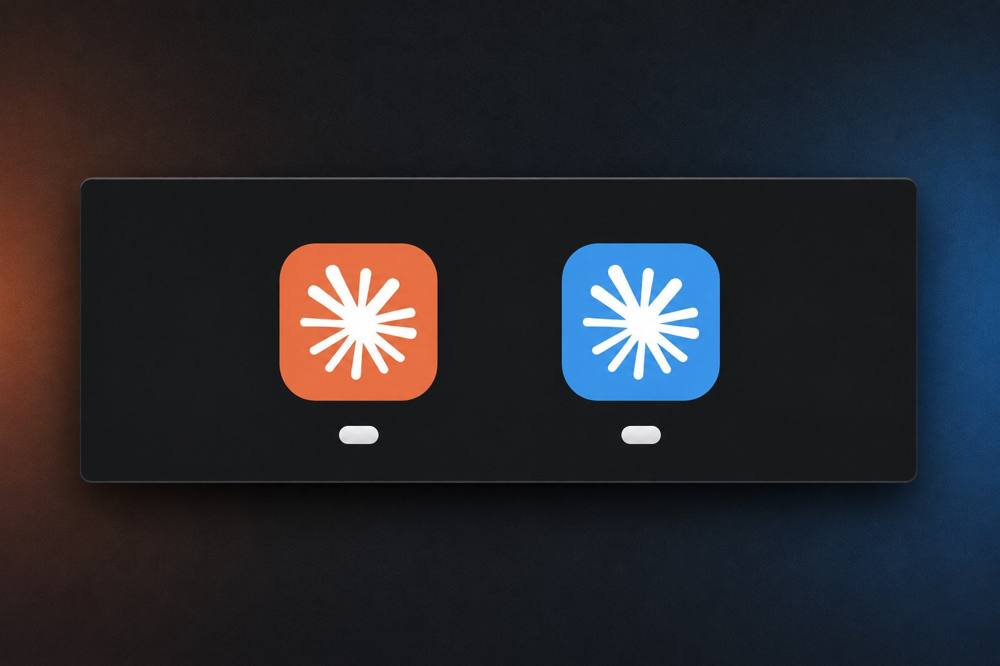

# Claude Desktop Side by Side

**English** | [Português (Brasil)](README.pt-BR.md) | [Español](README.es.md)

<p align="center">
  
</p>
<p align="center"><b>Your main Claude account in orange, a second account in blue.<br>Both open at the same time, each with its own taskbar button.</b></p>

> [!IMPORTANT]
> **Sign in to each extra profile with "Continue with email" and type the code you receive. Don't use "Continue with Google".**
> Google sign-in (and the link in the email) sends you back to your main Claude window, so the new profile never finishes signing in. [Details](#sign-in-important)

Run **two or more Claude Desktop accounts at the same time**, for example a personal account and a work account, or accounts for two different companies. Each one gets its own window and its own **colored icon**.

No more logging out and back in to switch accounts.

| Platform | Status | What you get |
|---|---|---|
| **Windows 10/11** | ✅ Tested | Separate accounts side by side, colored desktop/Start-menu shortcut **and colored taskbar button** |
| **macOS** | 🧪 Experimental, untested | Separate accounts side by side, colored launcher app (Dock/Launchpad/Spotlight). The running window keeps the normal Claude Dock icon |

> **Unofficial community workaround.** Not affiliated with, endorsed by, or supported by Anthropic. It relies on standard Electron and OS behavior, not on a documented Claude feature, so an app update could break it. Native multi-account support is requested in [anthropics/claude-code#18435](https://github.com/anthropics/claude-code/issues/18435). If you want it too, add a 👍 there.

## How it works

- Each profile is a separate Claude Desktop instance started with Electron's `--user-data-dir` switch, so it has its **own login, settings and history**. Your normal Claude Desktop is untouched and stays your "main" account.
- The colored icon is generated **locally** from your own installed Claude app by shifting its hue. Nothing is downloaded.
- On Windows, the launcher also gives the profile's window its own taskbar identity (AppUserModelID), so it gets its own colored taskbar button.

---

## Windows

### Requirements

- Windows 10 or 11
- Claude Desktop from [claude.ai/download](https://claude.ai/download) or the Microsoft Store
- Windows PowerShell 5.1 (built in)

Tested on Windows 11 with Claude Desktop 4.23118 (Microsoft Store/MSIX version). The classic installer is supported by the script but less tested. Reports are welcome.

### Install a profile

1. Download [`claude-profile.ps1`](claude-profile.ps1) and read it. Always read scripts before you run them.
2. Open PowerShell in the folder where you saved it and run:

   ```powershell
   powershell -ExecutionPolicy Bypass -File .\claude-profile.ps1 -Install -Name Work -Color blue
   ```

   - `-Name`: letters, numbers, `-` and `_` only (e.g. `Work`, `AcmeCorp`, `Personal`).
   - `-Color`: see [Colors](#colors).

   This creates a **Claude (Work)** shortcut on your desktop and in the Start menu. It also copies the script to `%LOCALAPPDATA%\ClaudeProfiles\`, so the shortcuts keep working if you delete the download.

3. Repeat with another name for each extra account.
4. Open **Claude (Work)** and sign in with **Continue with email**, then type the code from the email. Don't use Google ([why](#sign-in-important)).

### Everyday use

- Open each account from its shortcut. The main app and all profiles can run at the same time.
- **Taskbar:** a few seconds after opening, the profile's taskbar button switches to its color and separates from the main Claude button.
- **Pin it:** right-click the *colored taskbar button* of the running profile and choose **Pin to taskbar**. The pin keeps the color and opens that profile.
- If a profile window was opened some other way (not via its shortcut or pin), it may show the default icon. Open it from the shortcut again to fix it.

### Other commands

```powershell
$cp = "$env:LOCALAPPDATA\ClaudeProfiles\claude-profile.ps1"

powershell -ExecutionPolicy Bypass -File $cp -List                               # list profiles
powershell -ExecutionPolicy Bypass -File $cp -Install -Name Work -Color purple    # change color (keeps login)
powershell -ExecutionPolicy Bypass -File $cp -Uninstall -Name Work                # remove shortcuts, keep login data
powershell -ExecutionPolicy Bypass -File $cp -Uninstall -Name Work -RemoveData    # remove everything for that profile
powershell -ExecutionPolicy Bypass -File $cp -Name Work -OpenUrl "claude://..."   # send a sign-in link to this profile
```

Close the profile window (and quit it from the system tray) before uninstalling.

After changing a color, open the profile from its shortcut again. If you pinned it to the taskbar, unpin and re-pin it, because Windows caches pinned icons.

### Where data lives

| | Location |
|---|---|
| Script + icons | `%LOCALAPPDATA%\ClaudeProfiles\` |
| Profile data (Store version) | `%LOCALAPPDATA%\Packages\Claude_<id>\LocalCache\Roaming\Claude-<Name>` (Windows redirects app data for Store apps) |
| Profile data (classic installer) | `%APPDATA%\Claude-<Name>` |

---

## Claude Code in the terminal (CLI)

### One command per account

Add `-Cli` when you install a profile and you also get a **terminal command for that account**, with its own login and its own conversations:

```powershell
powershell -ExecutionPolicy Bypass -File .\claude-profile.ps1 -Install -Name Work -Color blue -Cli
```

- Run `claude-work` instead of `claude`. The first time, it asks you to log in to that account.
- Works in **PowerShell, CMD and PowerShell 7**. The command file is placed next to your `claude` command, so nothing is added to your PATH or your PowerShell profile.
- Its login and conversations live in `%USERPROFILE%\.claude-work`, separate from your other accounts.
- Requires [Claude Code](https://docs.claude.com/en/docs/claude-code) to be installed.
- macOS: `./claude-profile.sh install Work blue --cli` creates the same `claude-work` command.

### Move a conversation to another account: `claude-sync` (experimental, Windows)

Ran out of usage in one account? Send the conversation to another account and keep going. `-Cli` installs the `claude-sync` command. Run it **inside the project folder**, after closing that conversation in Claude:

```
claude-sync

Conversations in C:\Users\me\Desktop\my-app
  #   Last used    In                 Conversation
  1   06/11 14:02  Personal           Start a simple Hello World landing page in HTML and CSS
  2   05/11 09:10  Work               Fix the contact form validation

Which conversations? (e.g. 1  or  1,3  or  all)   > 1
Send to which account?                            > Work
Copy or move? (C = keep it in the others too, M = remove it from the others)   > C
```

Then open the same folder with that account: `claude-work`, then `/resume`. Or, in Claude Desktop, choose **Desktop** as the account and use **Code tab > Import Claude Code CLI Sessions…**.

- Only the conversations you pick are copied, and the newest copy always wins. Going back later? Send it back the same way (choose **Move** to remove it from the account you borrowed).
- **Move** sends the other copies to the Recycle Bin. Claude Desktop's copy is never removed by the script: delete it in the app.
- **Memory is never copied.** Each account keeps its own memory notes per project folder.
- Moved or renamed a project folder? Run `claude-sync -From "C:\old\path"` in the new folder to bring its conversations along.
- Without the menu: `claude-sync -Select 1 -To Work`, `claude-sync -Select 1 -To Personal -Move`, `claude-sync -List`, `claude-sync -DryRun`.
- From any folder, `/resume` then **Ctrl+A** shows conversations from all projects. A conversation belongs to the folder it was started in, so keep that folder where it is.

Tested on Windows 11 with Claude Code 2.1.318: a conversation started in one account, continued in another, and moved back keeps its full history. **Experimental:** it relies on how Claude Code currently stores conversations, so an update could break it.

---

## macOS (experimental)

> 🧪 **Untested.** The macOS script uses the same Electron mechanism as the Windows one, but it hasn't been run on a Mac yet. If you try it, please file a [macOS test report](../../issues/new?template=macos_test_report.yml), even if everything worked.

### What to expect

- ✅ Separate accounts side by side (each profile is its own Claude instance with its own data folder).
- ✅ A **Claude (Work).app** launcher in `~/Applications` with a recolored icon, which you can keep in the Dock or open from Spotlight/Launchpad.
- ❌ **The running window still shows the normal orange Claude icon in the Dock.** macOS doesn't let another program change a running app's Dock icon. That would require modifying Claude.app itself, which breaks its signature and updates, so this project doesn't do it. Tell the windows apart by the account shown inside the app.

### Install a profile

```bash
curl -O https://raw.githubusercontent.com/pdmoura/claude-desktop-side-by-side/main/claude-profile.sh
less claude-profile.sh           # read it first
chmod +x claude-profile.sh
./claude-profile.sh install Work blue
```

Then open **Claude (Work)** from Spotlight, Launchpad or `~/Applications`, drag it to the Dock if you like, and sign in with **Continue with email** + the code (not Google, [why](#sign-in-important)).

### Other commands

```bash
cp="$HOME/Library/Application Support/ClaudeProfiles/claude-profile.sh"

"$cp" list                             # list profiles
"$cp" install Work purple              # change color (keeps login)
"$cp" launch Work                      # open without the launcher app
"$cp" uninstall Work                   # remove the launcher, keep login data
"$cp" uninstall Work --remove-data     # remove everything for that profile
"$cp" launch Work "claude://..."       # try sending a sign-in link to this profile (unverified on macOS)
```

Profile data lives in `~/Library/Application Support/Claude-<Name>`.

### Requirements

macOS with Claude Desktop in `/Applications` or `~/Applications`. Only built-in tools are used (`open`, `sips`, `iconutil`, `osascript`/Core Image).

---

## Sign in (important)

This applies to every platform. Open the profile, then:

1. Click **Continue with email**, not "Continue with Google".
2. Enter the account's email (Gmail and Google Workspace addresses work too).
3. **Type the code** from the email into the app. Don't click the link in the email.

**Why:** Google sign-in and the email link both return to the app through a `claude://` link. The operating system delivers that link to your *main* Claude app, so the profile window would wait forever. The email code keeps the whole sign-in inside the profile window. You only do this once, and the profile stays signed in.

If your organization only allows Google/SSO sign-in, copy the `claude://...` link from the browser instead of letting it open Claude, and pass it to the profile with the `-OpenUrl` (Windows) or `launch Work "claude://..."` (macOS) command shown above.

## Colors

`red`, `orange`, `yellow`, `green`, `teal`, `blue`, `indigo`, `purple`, `pink`, or any hue number from `0` to `360` (for example `195` for sky blue or `300` for magenta).

The color is a hue shift of the Claude logo, so it keeps Claude's brightness and saturation. Black, white, grey and exact brand hex colors aren't supported.

## Limitations

- Unofficial: a Claude Desktop update could change how this behaves.
- Each profile is a full app instance, so it uses as much memory as a second Claude window would.
- Windows: Alt+Tab may still show the default Claude icon. A small hidden PowerShell process runs for a few seconds when a profile opens (to set the taskbar icon), then exits.
- macOS: see [What to expect](#what-to-expect).

## Contributing

Bug reports, macOS test reports and pull requests are welcome. See [CONTRIBUTING.md](CONTRIBUTING.md) for how changes are reviewed and merged, and [SECURITY.md](SECURITY.md) to report a vulnerability privately.

## License

MIT. See [LICENSE](LICENSE).
