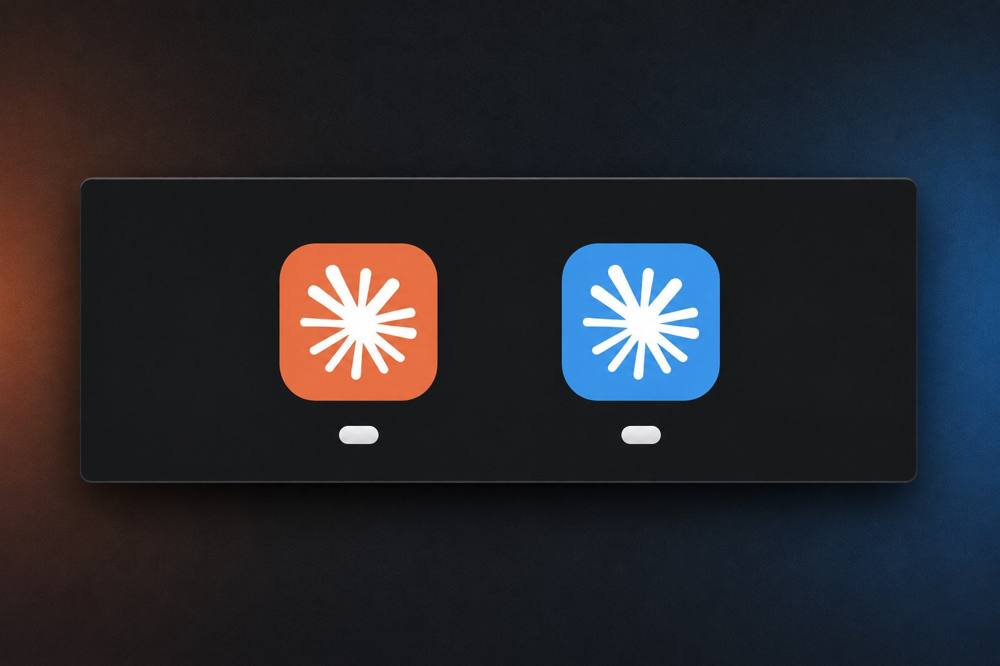

# Claude Desktop Side by Side

[English](README.md) | **Português (Brasil)** | [Español](README.es.md)

<p align="center">
  
</p>
<p align="center"><b>Sua conta principal do Claude em laranja, uma segunda conta em azul.<br>As duas abertas ao mesmo tempo, cada uma com seu próprio botão na barra de tarefas.</b></p>

> [!IMPORTANT]
> **Para entrar em cada perfil extra, use "Continue with email": digite seu e-mail e depois digite no app o código que você receber. Não clique no link do e-mail e não use "Continue with Google".**
> O login com Google (e o link do e-mail) te leva de volta para a janela principal do Claude, e o novo perfil nunca termina o login. [Detalhes](#sign-in-important)

Use **duas ou mais contas do Claude Desktop ao mesmo tempo**, por exemplo uma conta pessoal e uma do trabalho, ou contas de duas empresas diferentes. Cada uma ganha sua própria janela e seu próprio **ícone colorido**.

Chega de sair e entrar de novo para trocar de conta.

**Ir para:** [Instalar no Windows](#install-windows) · [Instalar no macOS](#macos-experimental) · [Entrar na conta](#sign-in-important) · [`/handoff`](#handoff)

| Plataforma | Status | O que você ganha |
|---|---|---|
| **Windows 10/11** | ✅ Testado | Contas separadas lado a lado, atalho colorido na área de trabalho e no menu Iniciar **e botão colorido na barra de tarefas**, além do [`/handoff`](#handoff) para continuar uma conversa do Claude Code em outra conta |
| **macOS** | 🧪 Experimental, não testado | Contas separadas lado a lado e um app de atalho colorido (Dock/Launchpad/Spotlight). A janela aberta continua com o ícone normal do Claude no Dock |

> **Solução alternativa não oficial, feita pela comunidade.** Não é afiliada, endossada nem suportada pela Anthropic. Ela usa comportamentos padrão do Electron e do sistema operacional, não um recurso documentado do Claude, então uma atualização do app pode quebrá-la. O suporte nativo a várias contas foi pedido em [anthropics/claude-code#18435](https://github.com/anthropics/claude-code/issues/18435). Se você também quer isso, deixe um 👍 lá.

## Como funciona

- Cada perfil é uma instância separada do Claude Desktop, aberta com a opção `--user-data-dir` do Electron. Por isso cada uma tem **seu próprio login, configurações e histórico**. Seu Claude Desktop normal não é alterado e continua sendo sua conta "principal".
- O ícone colorido é gerado **no seu computador**, a partir do Claude instalado, mudando o tom da cor. Nada é baixado.
- No Windows, o atalho também dá à janela do perfil uma identidade própria na barra de tarefas (AppUserModelID), para que ela tenha seu próprio botão colorido.

---

## Windows

### Requisitos

- Windows 10 ou 11
- Claude Desktop instalado pelo [claude.ai/download](https://claude.ai/download) ou pela Microsoft Store
- Windows PowerShell 5.1 (já vem no Windows)

Testado no Windows 11 com o Claude Desktop 4.23118 (versão da Microsoft Store/MSIX). O instalador clássico é suportado pelo script, mas foi menos testado. Relatos são bem-vindos.

<a id="install-windows"></a>
### Criar um perfil

Há duas formas de instalar. As duas fazem exatamente a mesma coisa, então escolha uma.

#### Instalação rápida (uma linha)

1. Abra o menu **Iniciar**, digite `powershell` e aperte **Enter**. O Prompt de Comando (`cmd`) também funciona.
2. Copie esta linha, cole na janela (**Ctrl+V** ou botão direito do mouse) e aperte **Enter**:

   ```powershell
   powershell -NoProfile -ExecutionPolicy Bypass -Command "cd ([IO.Path]::GetTempPath()); iwr https://github.com/pdmoura/claude-desktop-side-by-side/archive/refs/heads/main.zip -OutFile claude-side-by-side.zip -UseBasicParsing; Expand-Archive claude-side-by-side.zip claude-side-by-side -Force; & .\claude-side-by-side\claude-desktop-side-by-side-main\claude-profile.ps1 -Install -Name Trabalho -Color blue"
   ```

   O final da linha, `-Name Trabalho -Color blue`, é o nome da conta e a cor do ícone. Você pode trocar os dois antes de apertar Enter: veja [Opções](#install-options).

Isso baixa a versão atual deste projeto para a sua pasta Temp e roda o instalador na hora. Se você prefere ler os scripts antes de executá-los, use o passo a passo abaixo.

#### Passo a passo (baixando antes)

1. **Baixe os arquivos.** No topo desta página, clique no botão verde **Code** e depois em **Download ZIP**. Na pasta Downloads, clique com o botão direito no arquivo ZIP e escolha **Extrair tudo**. Se você usa Git, também pode clonar: `git clone https://github.com/pdmoura/claude-desktop-side-by-side.git`

   Leia os scripts antes de executá-los, como você deve fazer com qualquer script da internet. O [`claude-profile.ps1`](claude-profile.ps1) é o instalador. O [`claude-handoff.ps1`](claude-handoff.ps1) e a pasta [`skills`](skills/handoff/SKILL.md) adicionam o [`/handoff`](#handoff).
2. **Abra o PowerShell nessa pasta.** Abra a pasta extraída no Explorador de Arquivos. Se só aparecer outra pasta com o mesmo nome, abra essa também: você está no lugar certo quando enxergar o arquivo `claude-profile.ps1`. Depois clique na barra de endereço no topo, digite `powershell` e aperte **Enter**. Uma janela do PowerShell abre, já na pasta certa.
3. **Rode o instalador.** Copie esta linha, cole na janela do PowerShell (**Ctrl+V** ou botão direito do mouse) e aperte **Enter**:

   ```powershell
   powershell -ExecutionPolicy Bypass -File .\claude-profile.ps1 -Install -Name Trabalho -Color blue
   ```

<a id="install-options"></a>
#### Opções

Elas ficam no final da linha de instalação, em qualquer uma das duas formas. Na instalação rápida, mantenha tudo antes das aspas `"` do final.

- `-Name`: um nome para essa conta. Só letras sem acento, números, `-` e `_` (ex.: `Trabalho`, `EmpresaX`, `Pessoal`).
- `-Color`: a cor do ícone. Veja [Cores](#colors).
- **Opcional, só se você usa o Claude Code no terminal:** adicione `-Cli` depois da cor. Isso também cria o comando `claude-trabalho`, que abre o Claude Code no terminal com essa conta. Precisa do [Claude Code](https://docs.claude.com/en/docs/claude-code) instalado (o comando `claude`), e na primeira vez pede para você entrar na conta.

#### O que você deve ver

Quando termina, a janela mostra `Profile 'Trabalho' installed.` e um atalho **Claude (Trabalho)** aparece na área de trabalho e no menu Iniciar. Se aparecer uma mensagem de erro, [abra uma issue](../../issues) e cole a mensagem lá.

O instalador também copia os scripts para `%LOCALAPPDATA%\ClaudeProfiles\` e configura o [`/handoff`](#handoff) em todas as contas. Tudo fica instalado no seu usuário do Windows, não dentro da pasta baixada, então você pode apagar essa pasta depois: os atalhos continuam funcionando e o `/handoff` funciona em qualquer projeto.

#### Próximos passos

1. **Entre na conta.** Abra o **Claude (Trabalho)**, clique em **Continue with email**, digite seu e-mail e depois **digite no app o código** que chegar por e-mail. Não clique no link do e-mail e não use o Google ([por quê](#sign-in-important)).
2. **Adicione mais contas.** Rode a linha de instalação de novo, com outro nome e outra cor, para cada conta extra.

### Uso no dia a dia

- Abra cada conta pelo seu atalho. O app principal e todos os perfis podem ficar abertos ao mesmo tempo.
- **Barra de tarefas:** alguns segundos depois de abrir, o botão do perfil na barra de tarefas muda para a cor dele e se separa do botão do Claude principal.
- **Fixar:** clique com o botão direito no *botão colorido* do perfil aberto e escolha **Fixar na barra de tarefas**. O botão fixado mantém a cor e abre aquele perfil.
- Se a janela de um perfil for aberta de outro jeito (sem ser pelo atalho ou pelo botão fixado), ela pode aparecer com o ícone padrão. Abra pelo atalho de novo para corrigir.

### Outros comandos

```powershell
$cp = "$env:LOCALAPPDATA\ClaudeProfiles\claude-profile.ps1"

powershell -ExecutionPolicy Bypass -File $cp -List                                   # listar perfis
powershell -ExecutionPolicy Bypass -File $cp -Install -Name Trabalho -Color purple    # mudar a cor (mantém o login)
powershell -ExecutionPolicy Bypass -File $cp -Uninstall -Name Trabalho                # remover atalhos, manter o login
powershell -ExecutionPolicy Bypass -File $cp -Uninstall -Name Trabalho -RemoveData    # remover tudo desse perfil
powershell -ExecutionPolicy Bypass -File $cp -Name Trabalho -OpenUrl "claude://..."   # enviar um link de login para esse perfil
```

Feche a janela do perfil (e saia dele pela bandeja do sistema) antes de desinstalar.

Depois de mudar a cor, abra o perfil pelo atalho de novo. Se você fixou o perfil na barra de tarefas, desafixe e fixe de novo, porque o Windows guarda em cache os ícones fixados.

<a id="handoff"></a>
### Continuar uma conversa em outra conta (/handoff)

**Isto é só para o Claude Code**: a aba **Code** do Claude Desktop, ou o `claude` no terminal. Os chats normais não mudam. Se você não usa o Claude Code, pode pular esta seção.

Normalmente, uma conversa do Claude Code fica na conta em que você começou. Com o `/handoff` você leva a conversa para outra conta e continua lá, com tudo o que já foi dito. Depois dá para trazer de volta do mesmo jeito.

**Exemplo:** você começou uma conversa na janela principal do Claude e quer continuar no **Claude (Trabalho)**.

1. Na conversa, digite `/handoff Trabalho` e envie. Use o nome que você deu ao perfil quando instalou. O Claude faz o resto e avisa quando terminar.
2. Não mande mais mensagens nessa conversa na janela principal.
3. Se o **Claude (Trabalho)** já estiver aberto, feche por completo: clique com o botão direito no ícone dele perto do relógio (na bandeja do sistema) e escolha **Sair**. Depois abra de novo pelo atalho.
4. No **Claude (Trabalho)**, vá para a aba **Code**. A conversa está na barra lateral, dentro da mesma pasta do projeto. Clique nela e continue.

Para trazer de volta, digite `/handoff Desktop` no **Claude (Trabalho)** (`Desktop` é a conta da janela principal do Claude) e siga os mesmos passos.

**No terminal** (se você instalou com `-Cli`): depois do handoff, abra um terminal na mesma pasta do projeto, rode o comando da conta (por exemplo `claude-trabalho`), digite `/resume` e escolha a conversa.

| Digite | O que faz |
|---|---|
| `/handoff Trabalho` | Leva esta conversa para a conta Trabalho: a janela dela e o comando `claude-trabalho` |
| `/handoff Desktop` | Leva para a conta da janela principal do Claude |
| `/handoff refresh` | Deixa a janela e o comando de terminal desta conta com a mesma cópia, para você poder alternar entre eles |

**Bom saber**

- **Faça o handoff logo antes de trocar.** Cada janela e cada comando de terminal guarda a sua própria cópia da conversa, e o handoff copia a conversa como ela está naquele momento. O que você mandar depois fica só onde você mandou. Isso vale também para trocar entre a janela e o terminal da mesma conta: use `/handoff refresh` nesse caso.
- **Arquive, não apague.** Para tirar de uma conta uma conversa que você levou para outra, arquive. Apagar pode apagar a conversa também nas outras contas.
- **"Continuou em mais de um lugar":** quer dizer que foram mandadas mensagens em duas contas sem um handoff no meio. Nada é alterado. O Claude mostra quais cópias têm mensagens que as outras não têm e pergunta qual manter. As outras são guardadas como arquivos de backup (`.diverged`), nunca apagadas.
- **Contas novas** recebem o `/handoff` automaticamente na próxima vez que você instalar um perfil.
- **Experimental, só no Windows.** Depende de como o Claude guarda as conversas hoje, o que não é documentado. Se uma atualização mudar isso, o `/handoff` para com um erro em vez de alterar qualquer coisa.

<details>
<summary>Comandos de terminal (avançado)</summary>

Rode no PowerShell, na pasta do projeto. Se o `claude-handoff` não for encontrado, use `powershell -ExecutionPolicy Bypass -File "$env:LOCALAPPDATA\ClaudeProfiles\claude-handoff.ps1"` no lugar dele.

```powershell
claude-handoff -List                             # contas e as conversas desta pasta
claude-handoff -To Trabalho                      # handoff da conversa mais recente desta pasta
claude-handoff -To Trabalho -Session 12eb8934    # uma conversa específica (id do -List)
claude-handoff -To Trabalho -Prefer Desktop      # continuou em dois lugares: manter a cópia do Desktop
claude-handoff -To Trabalho -DryRun              # mostrar o que aconteceria, sem mudar nada
claude-handoff -Install                          # adicionar o /handoff em todas as contas agora
```

</details>

### Onde ficam os dados

| | Local |
|---|---|
| Scripts e ícones | `%LOCALAPPDATA%\ClaudeProfiles\` |
| Dados do perfil (versão da Store) | `%LOCALAPPDATA%\Packages\Claude_<id>\LocalCache\Roaming\Claude-<Nome>` (o Windows redireciona os dados de apps da Store) |
| Dados do perfil (instalador clássico) | `%APPDATA%\Claude-<Nome>` |
| Conversas do Claude Code no app (todas as janelas) | `%USERPROFILE%\.claude\projects` |
| Conversas do Claude Code no comando `claude-<nome>` | `%USERPROFILE%\.claude-<nome>\projects` |
| Skill `/handoff` | `skills\handoff` dentro de cada uma das duas pastas acima |

---

## macOS (experimental)

> 🧪 **Não testado.** O script de macOS usa o mesmo mecanismo do Electron que o de Windows, mas ainda não foi executado em um Mac. Se você testar, envie um [relatório de teste no macOS](../../issues/new?template=macos_test_report.yml), mesmo que tudo tenha funcionado.

<a id="what-to-expect"></a>
### O que esperar

- ✅ Contas separadas lado a lado (cada perfil é uma instância própria do Claude, com sua própria pasta de dados).
- ✅ Um app de atalho **Claude (Trabalho).app** em `~/Applications` com ícone colorido, que você pode deixar no Dock ou abrir pelo Spotlight/Launchpad.
- ❌ **A janela aberta continua mostrando o ícone laranja normal do Claude no Dock.** O macOS não deixa outro programa mudar o ícone de um app que já está rodando no Dock. Para isso seria preciso modificar o próprio Claude.app, o que quebra a assinatura e as atualizações, então este projeto não faz isso. Diferencie as janelas pela conta mostrada dentro do app.

### Criar um perfil

```bash
curl -O https://raw.githubusercontent.com/pdmoura/claude-desktop-side-by-side/main/claude-profile.sh
less claude-profile.sh           # leia antes
chmod +x claude-profile.sh
./claude-profile.sh install Trabalho blue
```

Depois abra o **Claude (Trabalho)** pelo Spotlight, pelo Launchpad ou por `~/Applications`, arraste para o Dock se quiser e entre na conta: clique em **Continue with email**, digite seu e-mail e depois **digite no app o código** que chegar por e-mail. Não clique no link do e-mail e não use o Google ([por quê](#sign-in-important)).

### Outros comandos

```bash
cp="$HOME/Library/Application Support/ClaudeProfiles/claude-profile.sh"

"$cp" list                                 # listar perfis
"$cp" install Trabalho purple              # mudar a cor (mantém o login)
"$cp" launch Trabalho                      # abrir sem o app de atalho
"$cp" uninstall Trabalho                   # remover o atalho, manter o login
"$cp" uninstall Trabalho --remove-data     # remover tudo desse perfil
"$cp" launch Trabalho "claude://..."       # tentar enviar um link de login para esse perfil (não verificado no macOS)
```

Os dados do perfil ficam em `~/Library/Application Support/Claude-<Nome>`.

### Requisitos

macOS com o Claude Desktop em `/Applications` ou `~/Applications`. Só são usadas ferramentas que já vêm no sistema (`open`, `sips`, `iconutil`, `osascript`/Core Image).

---

<a id="sign-in-important"></a>
## Entrar na conta (importante)

Vale para todas as plataformas. Abra o perfil e então:

1. Clique em **Continue with email** (ou a opção de e-mail equivalente, se o app estiver em português). Não use "Continue with Google".
2. Digite o e-mail da conta (endereços do Gmail e do Google Workspace também funcionam).
3. **Digite o código** que chegar por e-mail no app. Não clique no link do e-mail.

**Por quê:** o login com Google e o link do e-mail voltam para o app por um link `claude://`. O sistema operacional entrega esse link para o seu Claude *principal*, e a janela do perfil fica esperando para sempre. O código por e-mail mantém todo o login dentro da janela do perfil. Você só faz isso uma vez, e o perfil continua conectado.

Se a sua empresa só permite login com Google/SSO, copie o link `claude://...` no navegador em vez de deixá-lo abrir o Claude, e passe-o para o perfil com o comando `-OpenUrl` (Windows) ou `launch Trabalho "claude://..."` (macOS) mostrados acima.

<a id="colors"></a>
## Cores

`red` (vermelho), `orange` (laranja), `yellow` (amarelo), `green` (verde), `teal` (verde-azulado), `blue` (azul), `indigo` (índigo), `purple` (roxo), `pink` (rosa), ou qualquer número de matiz de `0` a `360` (por exemplo `195` para azul-celeste ou `300` para magenta). Use os nomes em inglês no comando.

A cor é uma mudança de matiz do logo do Claude, então mantém o brilho e a saturação originais. Preto, branco, cinza e cores exatas em hexadecimal não são suportados.

## Limitações

- Não oficial: uma atualização do Claude Desktop pode mudar esse comportamento.
- Cada perfil é uma instância completa do app, então usa tanta memória quanto uma segunda janela do Claude.
- Windows: o Alt+Tab ainda pode mostrar o ícone padrão do Claude. Um pequeno processo oculto do PowerShell roda por alguns segundos quando um perfil abre (para definir o ícone da barra de tarefas) e depois fecha.
- O `/handoff` depende de formatos internos não documentados do Claude, e as cópias dele são instantâneos: veja [/handoff](#handoff).
- macOS: veja [O que esperar](#what-to-expect).

## Como contribuir

Relatos de bugs, relatórios de teste no macOS e pull requests são bem-vindos. Veja o [CONTRIBUTING.md](CONTRIBUTING.md) (em inglês) para saber como as mudanças são revisadas e aceitas, e o [SECURITY.md](SECURITY.md) para relatar uma vulnerabilidade de forma privada. Issues e pull requests podem ser escritos em português, inglês ou espanhol.

## Licença

MIT. Veja [LICENSE](LICENSE).
